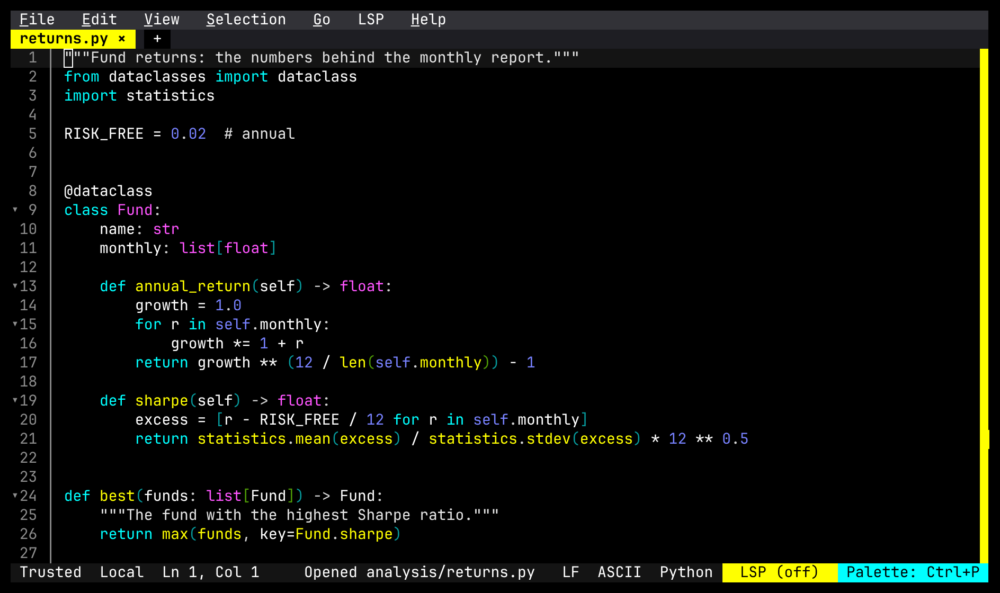
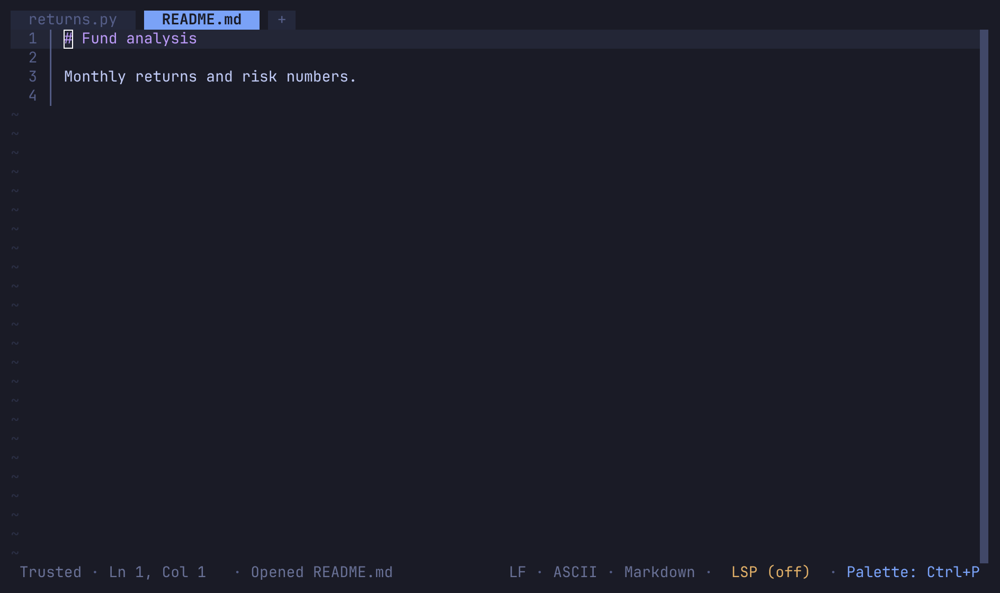
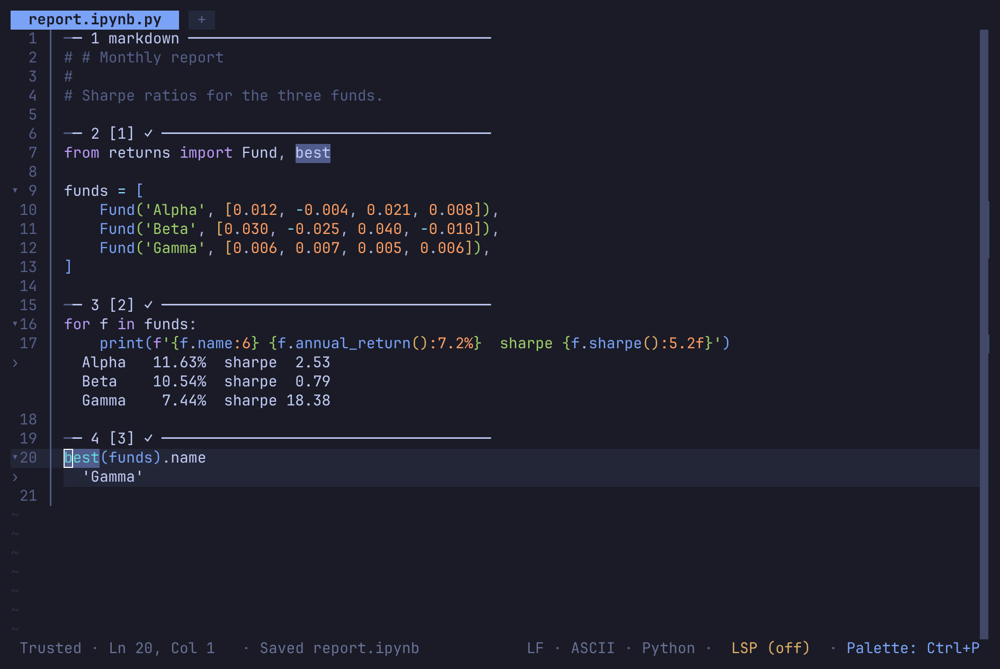

# Fresh, herdr edition

This is a fork of [Fresh](https://github.com/sinelaw/fresh) for the wr/herdr team environment
(`Etunder/herdr-wr`). It is meant to diverge, not to be merged back. Fresh runs inside a herdr pane
in WezTerm on Windows, so the fork:

- **looks like herdr**: the built-in `herdr` theme is the default (herdr's Tokyo Night palette), and
  the chrome is restyled after herdr's (see [style.md](style.md)). The fork's defaults live in
  `crates/fresh-editor-core/herdr-defaults.json`, a config layer under the user's own config, so any
  of them can be changed back in settings: `"theme"`, `"editor.show_menu_bar"`,
  `"editor.chrome_style": "fresh"` (Fresh's own tab bar and layout), `"editor.status_bar"`. The test
  suite builds on `Config::default()`, which stays upstream's;
- **opens Jupyter notebooks**: a `.ipynb` opens as its cells (the percent format, `# %%` lines drawn
  as quiet rules with the run count and time), outputs under each cell: text with its colours,
  plots and other images through the kitty graphics protocol, tables, typeset formulas. Alt+Enter
  (or Shift+Enter) runs a cell; `Notebook:` commands in the palette add, move, split, merge,
  convert and clear cells, interrupt and restart the kernel, and pick it. Completion and docs come
  from the kernel, errors and navigation from Python's language server (basedpyright); markdown
  cells render, display math typeset. Saving writes the notebook (byte-identical where nothing
  changed). The kernel side is herdr-wr's `nb serve` (setting `plugins.notebook.nbCommand`, default
  `nb` on PATH), which picks the repo's venv like `wr` does (`plugins/notebook.ts`; plan:
  `herdr-wr/docs/notebook-plan.md`);
- **drops what herdr already does**: no Orchestrator (workspaces, agent sessions, the dock);
  herdr manages the panes and the agents;
- **never updates itself from upstream**: self-update is not built in and the update check is
  off, so it can't replace itself with upstream Fresh or report to upstream's telemetry;
- **ships one Windows binary**: `herdr build` CI makes `fresh.exe`, attached to `v*` releases, and
  herdr-wr's `install.ps1` downloads it.

Upstream's release, packaging and publishing workflows are removed. To take upstream changes, merge
`sinelaw/fresh` `master` into this fork's `master`; the fork's own changes stay in their own
commits so conflicts are easy to read.

## Screenshots

| upstream Fresh | herdr edition |
|---|---|
|  |  |

A notebook, after running its cells and saving:

